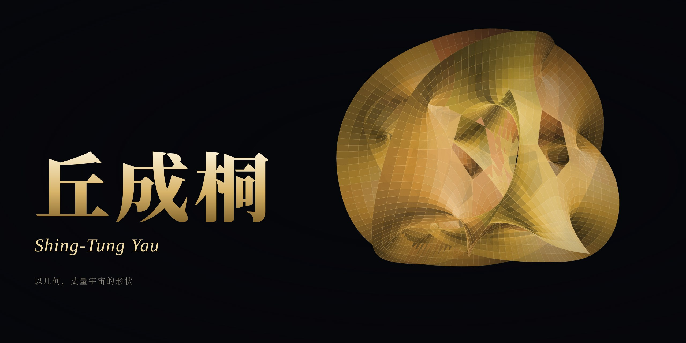
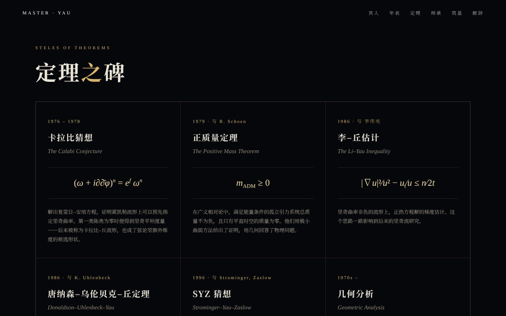
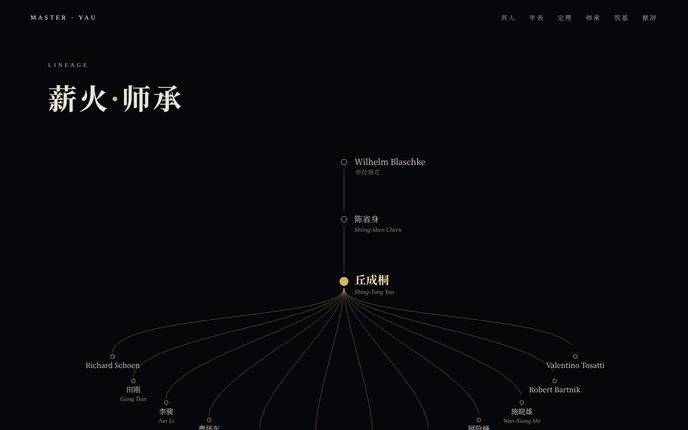

<p align="center">
  <a href="https://masteryau.com"></a>
</p>

<h1 align="center">Master Yau · 丘成桐的数学世界</h1>

<p align="center">
  <em>以几何，丈量宇宙的形状。</em><br>
  一个献给丘成桐先生的交互式数学人文网站
</p>

<p align="center">
  <a href="https://masteryau.com"></a>
  <a href="https://github.com/RanchoTao/Yau/actions/workflows/deploy-pages.yml"></a>
  
  
</p>

---

## 关于

**[masteryau.com](https://masteryau.com)** 想做的不是一份履历，而是一件可以走进去的数字作品：首屏是一个实时渲染、可以用手拖动旋转的卡拉比–丘流形，往下依次是丘先生的一生、他的定理、他的学生，以及他为数学建立的机构。

本站由学生自发制作，作为礼物献给丘先生，**并非丘成桐先生的官方网站**。

## 章节

| | 章节 | 内容 |
|---|---|---|
| ◈ | **首屏** | 费马五次超曲面 z₁⁵ + z₂⁵ = 1 的实切片投影，可拖动旋转、调节投影角 |
| ◇ | **其人** | 肖像、生平概述 |
| ◇ | **年表** | 1949 年至今的关键节点 |
| ◇ | **定理之碑** | 卡拉比猜想、正质量定理、李–丘估计、DUY 定理、SYZ 猜想、几何分析；每块碑都可点进一篇从零开始的原文讲解（中英双语） |
| ◇ | **薪火·师承** | Blaschke → 陈省身 → 丘成桐 → 学生，滚动时依次画出 |
| ◇ | **为数学·筑基** | 从香港中文大学数学所到 BIMSA、求真书院 |
| ◇ | **点亮一颗星** | 访客留言，在星空中点亮一颗星 |

<p align="center">
  
  
  
</p>

## 定理讲解

| 碑 | 页面 | 原文 |
|---|---|---|
| I | [卡拉比猜想](https://masteryau.com/calabi-yau/) | Yau, CPAM 1978 |
| II | [正质量定理](https://masteryau.com/positive-mass/) | Schoen–Yau, CMP 1979 |
| III | [李–丘估计](https://masteryau.com/li-yau/) | Li–Yau, Acta Math. 1986 |
| IV | [唐纳森–乌伦贝克–丘定理](https://masteryau.com/duy/) | Uhlenbeck–Yau, CPAM 1986 |
| V | [SYZ 猜想](https://masteryau.com/syz/) | Strominger–Yau–Zaslow, Nucl. Phys. B 1996 |
| VI | [几何分析](https://masteryau.com/geometric-analysis/) | 综述 |

每篇都按"一句话版本 → 背景 → 精确陈述 → 证明思路（含可点击的证明结构图）→ 影响 → 原文"的结构展开，右上角可切换中英文，首屏是与该定理相关的可拖动 3D 曲面（史瓦西喉部、热核、相扣环面、环面纤维化、悬链面–螺旋面）。

讲解由 AI 辅助撰写，**欢迎专业读者勘误**。页面由 `tools/build_explainers.py` 从 `tools/content/*.html` 生成（卡拉比猜想页为手写），公共样式与脚本在 `assets/explainer.css`、`assets/explainer.js`。

## 首屏流形是怎么画的

首屏没有用任何 3D 库，是用 Canvas 2D 一笔一笔画出来的。

费马五次曲面 z₁⁵ + z₂⁵ = 1 在 ℂ² 中可以分成 5 × 5 = 25 个曲面片。每个片用复参数 ζ = ξ + iθ 表示：

```
z₁ = e^{2πi·k₁/5} · cosh(ζ)^{2/5}
z₂ = e^{2πi·k₂/5} · (−i·sinh(ζ))^{2/5},   k₁, k₂ ∈ {0,…,4}
```

把四个实维度投影到三维，就得到 (Re z₁, Re z₂, cos α·Im z₁ + sin α·Im z₂)。这是 Andrew Hanson 在可视化卡拉比–丘流形时使用的经典方法，页面上的"投影角 α"指的就是这里的 α。

每一帧大约画 4,900 个四边形。先按深度从远到近排序（画家算法），再按法向量和光源的夹角计算明暗，最后用金色调上色。渲染只在首屏可见时进行，在手机上会自动降低网格密度。

## 技术

- **零依赖**：整个网站是一个 `index.html`，只额外加载 Google Fonts（Noto Serif SC、Cormorant Garamond）
- **原生实现**：Canvas 2D 负责流形和星空，SVG 负责师承树，IntersectionObserver 负责滚动出场
- **部署**：推送到 `main` 后，GitHub Actions 自动发布到 GitHub Pages，并绑定自定义域名 `masteryau.com`

```
.
├── index.html              # 主页
├── calabi-yau/ …          # 六篇定理讲解（中英双语，KaTeX）
├── tools/                  # 讲解页生成脚本与正文
├── assets/
│   ├── yau.webp            # 肖像（去背景、调色）
│   ├── favicon.svg
│   ├── apple-touch-icon.png
│   ├── og.jpg              # 社交分享预览图
│   └── explainer.{css,js}  # 讲解页公共样式与 3D 曲面渲染
├── docs/                   # README 用图，不参与部署
└── .github/workflows/deploy-pages.yml
```

在本地预览：

```bash
python3 -m http.server 8000   # 然后打开 http://localhost:8000
```

## 内容说明

- 页面中的生平、定理与机构信息整理自公开资料；学生名单是部分示意，仍在核实补全。
- 发现错误或有补充，欢迎提 [Issue](https://github.com/RanchoTao/Yau/issues)。
- 献辞墙目前只保存在访客自己的浏览器中，暂不上传到服务器。

## 作者

[Shengye (Rancho) Tao](https://ranchotao.com) · 北京雁栖湖应用数学研究院（BIMSA）数学与人工智能专业本科生

与 Claude（Anthropic）合作设计开发。

姊妹站点：[邬荣领 · 生命系统的数学](https://ranchotao.com/Wu/)

---

<p align="center"><sub>Made with reverence · 谨以此献给丘成桐先生</sub></p>
